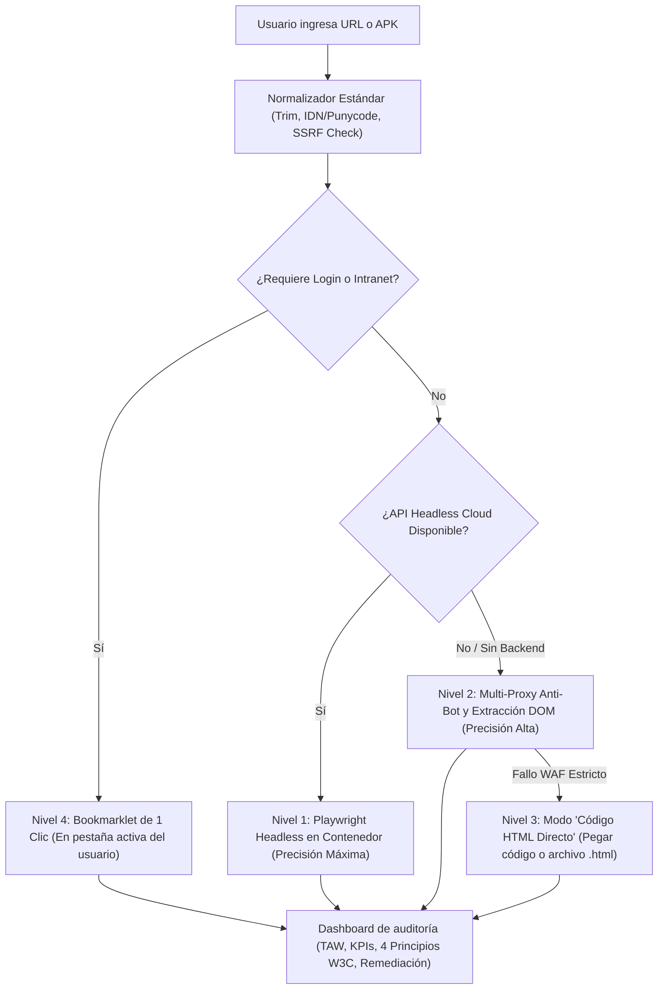

# A11y Agent 🌐🤖 — Auditor de Accesibilidad Web & Móvil
### Plataforma de Auditoría Digital (Modelo TAW / W3C WCAG 2.2 / EN 301 549)

Plataforma integral de auditoría y remediación de accesibilidad digital conforme a las pautas **W3C WCAG 2.0 / 2.1 / 2.2 (Niveles A, AA y AAA)** y el estándar europeo **EN 301 549 (Android)**. Inspirado en el **Modelo TAW (tawdis.net)**, determinista con motor oficial **axe-core 4.9.1**, análisis de layouts Android y remediación guiada con código interactivo (Antes / Después).

El indicador de 0 a 100 es una métrica heurística interna del agente: no es una certificación WCAG ni una puntuación oficial de TAW. Los motores pueden detectar y clasificar hallazgos de forma distinta; los resultados automáticos deben complementarse con revisión manual.

---

## 🌐 Enlaces Públicos Directos

* 🚀 **Plataforma Web Principal (GitHub Pages):** **[https://samuelcamacho2008.github.io/a11y-agent/](https://samuelcamacho2008.github.io/a11y-agent/)**
* 📂 **Portal de Auditorías y Reportes Públicos:** **[https://samuelcamacho2008.github.io/a11y-agent/portal.html](https://samuelcamacho2008.github.io/a11y-agent/portal.html)**
* 🔗 **Ruta Alternativa Directa:** [https://samuelcamacho2008.github.io/a11y-agent/agente-a11y/](https://samuelcamacho2008.github.io/a11y-agent/agente-a11y/)
* 📦 **Repositorio GitHub:** [https://github.com/SamuelCamacho2008/a11y-agent](https://github.com/SamuelCamacho2008/a11y-agent)

---

## ✨ Características y Capacidades de Accesibilidad

1. **🌐 Auditoría Web por URL (Cadena Multi-Nivel Anti-Bloqueos):**
   - **Nivel 1 (Máxima Precisión):** Navegador Headless Playwright en la nube (DOM hidratado en SPAs, cookies, estilos calculados y contraste exacto).
   - **Nivel 2 (Multi-Proxy Anti-Bot):** Fallback automático en cascada con Jina Reader, AllOrigins y CodeTabs para sortear bloqueos CORS/SOP.
   - **Nivel 3 (Código HTML Directo):** Análisis de fragmentos de código, plantillas o archivos `.html` subidos.
   - **Nivel 4 (Bookmarklet de 1 Clic):** Ejecución directa en páginas protegidas por login, intranets privadas o CAPTCHAs.

2. **📱 Auditoría de Aplicaciones Móviles Android (.APK):**
   - Descompilación e inspección de `AndroidManifest.xml` y layouts XML en el navegador (JSZip).
   - Verificación de atributos `android:contentDescription`, `android:importantForAccessibility`, tamaño mínimo de touch targets (48x48dp) y contraste de colores (EN 301 549).

3. **♿ Accesibilidad Nativa de la Interfaz (WCAG 2.2 Nivel AAA):**
   - **Contraste de color superior a 7:1** (`#cbd5e1` sobre fondo oscuro).
   - **Barra de herramientas rápida A11y:** Modo Alto Contraste (Blanco y Negro/Amarillo), selector de tamaño de fuente (A+ / A-), modo de lectura amplia para dislexia y pausado de animaciones (`reduce-motion`).
   - **Anunciador en vivo ARIA (`aria-live="polite"`):** Notificaciones dinámicas por voz para usuarios de lectores de pantalla (NVDA, JAWS, VoiceOver, TalkBack).
   - **Atajos de teclado:** `Alt + 1` (Web), `Alt + 2` (HTML), `Alt + 3` (APK), `Alt + 4` (Bookmarklet), `Alt + A` (Auditar), `Escape` (Limpiar/Cerrar).
   - **Visibilidad del foco mejorada:** Anillo de enfoque de alto contraste de 3px con desplazamiento.
   - **Objetivos táctiles adaptados:** Controles con altura y anchura mínima de 44x44px.

4. **📊 Dashboard y Modelo TAW:**
   - Desglose por los 4 Principios W3C: **Perceptible, Operable, Comprensible y Robusto**.
   - Clasificación en **Problemas** (errores automáticos comprobados), **Advertencias** (puntos que requieren validación visual) y **No verificados**.
   - Código sugerido de solución (Antes / Después) con botón de copiado de remediación.
   - Exportación de auditoría en JSON y HTML descargable o publicable.

---

## 🏛️ Arquitectura del Sistema



---

## 🧪 Pruebas Automatizadas

El proyecto incluye 48 pruebas unitarias y de integración que verifican la conformidad de seguridad, analizadores, generadores y paridad de producción:

```sh
# Ejecutar suite de pruebas Python
python -m pytest agente-a11y/tests -v
```

---

## 📁 Estructura del Proyecto

* **`agente-a11y/`**: Código fuente de la biblioteca Python `a11y_agent` (analizadores, Playwright crawler, reglas axe, exportadores y suite de tests).
* **`docs/`**: Distribución pública desplegada en GitHub Pages (`index.html`, `config.js`, `portal.html`, `reports/`, `reports.json`).
