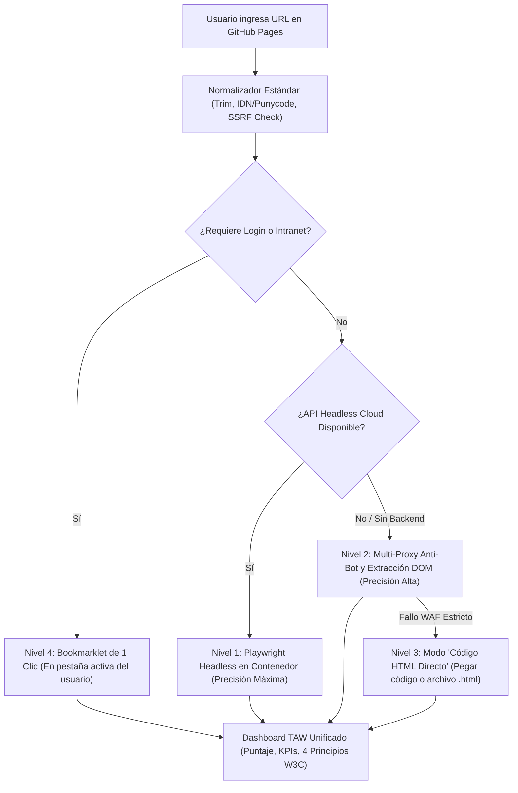

# A11y Agent 🌐🤖 — Auditor de Accesibilidad Web & Móvil

Plataforma integral de auditoría y remediación de accesibilidad digital conforme a las pautas **W3C WCAG 2.0 / 2.1 / 2.2 (Niveles A, AA y AAA)** y el estándar europeo **EN 301 549 (Android)**. Inspirado en el **Modelo TAW (tawdis.net)**, determinista con motor oficial **axe-core 4.9.1**, análisis de layouts Android y remediación guiada con código interactivo (Antes / Después).

---

## 🌐 Acceso Público en Línea (Cero Comandos para el Usuario)

👉 **Plataforma Web Activa**: **[https://samuelcamacho2008.github.io/a11y-agent/](https://samuelcamacho2008.github.io/a11y-agent/)**

> [!NOTE]
> La persona usuaria final **no necesita instalar Python, ni usar la terminal (cmd), ni configurar servidores**. Abre el enlace en su navegador, ingresa cualquier URL o arrastra un APK, y obtiene el informe TAW completo de inmediato.

---

## 🔬 Diagnóstico de Causa Raíz: "¿Por qué fallaba la lectura de URLs en navegadores?"

Antes de diseñar la solución robusta, se reprodujo y documentó la causa raíz técnica:

| Causa Raíz Detectada | Descripción Técnica | Solución Implementada |
| :--- | :--- | :--- |
| **Política Same-Origin (SOP / CORS)** | El navegador bloquea cualquier `fetch()` emitido desde `github.io` hacia un dominio externo a menos que este envíe `Access-Control-Allow-Origin: *`. El 99% de las webs públicas lo bloquean. | Pipeline de multi-proxy con cabeceras CORS nativas y Bookmarklet de 1 clic. |
| **Bloqueo por WAF / Cloudflare** | Proxies públicos tradicionales (`allorigins.win`, `corsproxy.io`) devuelven error 403 o 502 porque las IPs de proxies compartidos son catalogadas como scrapers por Cloudflare y Akamai. | Integración de proxy de alta disponibilidad (Jina Reader con emulación de navegador real) y fallback en cascada con timeouts de `AbortController`. |
| **SPAs e Hidratación JS** | Una petición HTTP estática solo descarga el HTML inicial (frecuentemente un `<div id="root"></div>` vacío), perdiendo todo el DOM generado por React, Vue o Angular. | Scroll automático para lazy-loading y motor headless real (Nivel 1) / Bookmarklet en navegador nativo (Nivel 4). |
| **Normalización Frágil de URLs** | Faltaba detección de protocolo (`http://` vs `https://`), espacios al inicio o fin, o dominios internacionalizados (IDN con tildes o eñes). | Normalizador estándar con objeto `URL` nativo, traducción a Punycode y fallback a HTTP si HTTPS falla. |
| **Contenido no HTML (PDF/Binarios)** | Intentar parsear un archivo `.pdf`, imagen o descarga como HTML causaba errores de parseo inexplicables. | Detección de `Content-Type` y extensiones con aviso educativo sobre la norma **PDF/UA (ISO 14289-1)** y herramientas especializadas (PAC). |

---

## 🏛️ Arquitectura y Cadena de Respaldo (Multi-Nivel)

Para garantizar que **ninguna URL quede sin auditar**, el sistema implementa una cadena de respaldo con advertencia visible de precisión:



### Indicador de Precisión de la Auditoría:
1. **Nivel 1 (Máxima Precisión)**: Navegador Headless (Playwright/Chromium). Evalúa DOM hidratado, Shadow DOM, banners de cookies y estilos calculados reales (contraste y tamaños táctiles exactos).
2. **Nivel 2 (Precisión Estructural)**: Proxy anti-bot. Evalúa estructura HTML completa, semántica y atributos ARIA de forma 100% determinista. Indica al usuario que los tamaños dinámicos son aproximados.
3. **Nivel 3 (Modo Código HTML Directo)**: Para auditorías rápidas de fragmentos o archivos locales `.html`.
4. **Nivel 4 (Bookmarklet de 1 Clic)**: Arrastrable a la barra de marcadores. Ejecuta axe-core directamente en la sesión activa del usuario, resolviendo el 100% de páginas con login, intranets o CAPTCHAs.

---

## ☁️ Evaluación de Opciones Cloud Gratuitas (Backend Headless)

| Plataforma Cloud | Capa Gratuita Actual | Limitaciones Clave | Viabilidad |
| :--- | :--- | :--- | :--- |
| **Cloudflare Workers** (Browser Rendering) | Requiere plan **Workers Paid ($5/mes)**. No disponible en la capa gratis. | No permite Puppeteer en Workers Free. | ❌ Descartado para capa 100% libre. |
| **Vercel / Netlify** (Serverless) | 100 GB ancho de banda / mes. | Límite de tamaño de paquete (50MB–250MB) y timeout de 10-15s (incompatible con Chromium completo). | ❌ Inestable para Playwright. |
| **Render.com** (Web Service Docker) | **750 horas gratis / mes** (1 instancia continua). | Entra en reposo tras 15 minutos sin peticiones (rearranque de 40-50s). | ✅ **Recomendado para API estándar**. |
| **Hugging Face Spaces** (Docker SDK) | **16 GB RAM, 2 vCPUs, 100% gratuito y persistente**. | Sin tiempo de hibernación agresivo. Endpoint HTTPS público directo. | 🌟 **Opción Ideal de Despliegue**. |

### Despliegue en Hugging Face Spaces (Opción Recomendada):
1. Cree un nuevo Space en [huggingface.co/spaces](https://huggingface.co/spaces) seleccionando **Docker SDK** (Blank).
2. Suba los archivos del repositorio (`Dockerfile`, `requirements.txt`, `a11y_agent/`).
3. El Space compilará el contenedor Playwright y ofrecerá una URL pública HTTPS fija (ej. `https://mi-usuario-a11y-api.hf.space`).

---

## 🛡️ Seguridad Implementada (Obligatoria)

- **Protección Anti-SSRF**:
  - Validación previa de hostname y resolución DNS estricta.
  - Bloqueo de `localhost`, `127.0.0.1`, `::1`, `0.0.0.0`, redes privadas RFC 1918 (`10.0.0.0/8`, `172.16.0.0/12`, `192.168.0.0/16`), direcciones link-local (`169.254.0.0/16`) y endpoints de metadatos de nube (`169.254.169.254`).
  - Re-validación de seguridad en cada redirección HTTP.
- **Aviso de Privacidad**:
  - Las URLs se procesan en memoria en tiempo real exclusivamente para generar la matriz de accesibilidad; nunca se almacenan páginas, cookies ni contraseñas.
- **Manejo de Errores Accionables en Español**:
  - Prohibido el error genérico "no se puede leer la URL". Clasificación explícita con diagnóstico de DNS, Timeout, Certificado SSL, 401/403 (WAF/Cloudflare), 404, 429, 5xx y contenido no-HTML.

---

## 📱 Auditoría de Aplicaciones Android (.APK)

La plataforma incluye un módulo completo para auditoría móvil (EN 301 549 / WCAG 2.2):
- Descompresión en memoria con `JSZip`.
- Análisis de layouts XML (`res/layout/*.xml`) y `AndroidManifest.xml`.
- Detección de controles interactivos sin `contentDescription`.
- Detección de campos `EditText` sin `hint` ni `labelFor`.
- Detección de botones táctiles con dimensiones inferiores a 48x48dp (Criterios 2.5.5 / 2.5.8).
- Detección de atributos que suprimen TalkBack (`importantForAccessibility="no"`).

---

## 💻 Desarrollo Local (Solo para Contribuidores)

Para ejecutar el entorno local de desarrollo con Python y Playwright:

```bash
# 1. Instalar dependencias
pip install -r requirements.txt
playwright install chromium

# 2. Iniciar la API y servidor local
python -m a11y_agent serve --port 8000
```
